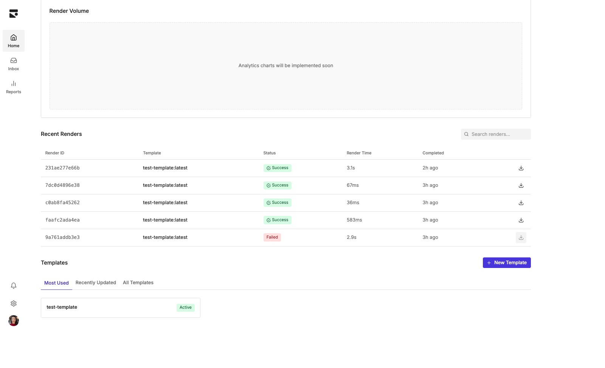

# 📄 Papermake

**Turn your [Typst](https://typst.app/) templates into PDF APIs. Publish once, render anywhere.**

Papermake is a content-addressable template registry with server-side rendering —
like a Docker registry, but for document templates.

```bash
# Publish a template
curl -X POST "localhost:3000/api/templates/invoice/publish?tag=latest" \
  -F "main_typ=@invoice.typ" \
  -F 'metadata={"name":"Invoice","author":"you@company.com"}'

# Render it with data
curl -X POST localhost:3000/api/render/invoice:latest \
  -H "Content-Type: application/json" \
  -d '{"data": {"company": "Acme Corp", "amount": 1500}}'
# → {"data":{"render_id":"e9c1…","pdf_hash":"sha256:8e0e…","duration_ms":42}}

# Download the PDF
curl localhost:3000/api/renders/e9c1…/pdf --output invoice.pdf
```

## Why Papermake?

- **Templates as code** — immutable versions, mutable tags: `invoice:v1.0.0` never changes, `invoice:latest` moves
- **Server-side rendering** — no local Typst installation, just HTTP
- **Content-addressable storage** — templates stored by SHA-256 hash and deduplicated, like Git
- **Full audit trail** — every render is logged with input/output hashes, so any PDF can be traced back to the exact template and data that produced it
- **Self-hostable** — one Rust binary plus S3 and ClickHouse

## Quick start

```bash
git clone https://github.com/rkstgr/papermake
cd papermake
docker compose up -d
```

This starts:

- **Papermake server** on `localhost:3000`
- **MinIO** (S3-compatible storage) on `localhost:9000`, console at `http://localhost:9001`
- **ClickHouse** (render history) on `localhost:8123`

Write a template — the input data is available as `#data`:

```typst
// invoice.typ
= Invoice #data.number

*Bill To:* #data.customer.name \
*Amount:* $#data.amount
```

Publish it, render it, download the PDF:

```bash
curl -X POST "localhost:3000/api/templates/invoice/publish?tag=latest" \
  -F "main_typ=@invoice.typ" \
  -F 'metadata={"name":"Invoice","author":"you@company.com"}'

curl -X POST localhost:3000/api/render/invoice:latest \
  -H "Content-Type: application/json" \
  -d '{"data": {"number": "INV-001", "customer": {"name": "Acme Corp"}, "amount": 1500}}'

# Use the render_id from the response above
curl localhost:3000/api/renders/<render_id>/pdf --output invoice.pdf
```

A template can also include additional files (images, imports, fonts) via repeated
`-F "files[]=@logo.png"` fields and an optional JSON schema via `-F "schema=@schema.json"`.
For quick experiments there is a JSON-only endpoint that takes the template inline:

```bash
curl -X POST localhost:3000/api/templates/hello/publish-simple \
  -H "Content-Type: application/json" \
  -d '{
    "main_typ": "Hello #data.name!",
    "metadata": {"name": "Hello", "author": "you@company.com"}
  }'
```

### Running without Docker

```bash
# Point the server at your S3 and ClickHouse instances
cp .env.example .env

cargo run -r -p papermake-server
```

## 🦀 Using the library

The core renderer is available as a standalone Rust library — no server, no
storage backends:

```toml
[dependencies]
papermake = "0.2"
```

```rust
use papermake::{render_template, InMemoryFileSystem};
use std::sync::Arc;

let template = "Hello #data.name!";
let fs = Arc::new(InMemoryFileSystem::new());
let data = serde_json::json!({ "name": "World" });

let result = render_template(template.to_string(), fs, &data)?;
if result.success {
    std::fs::write("hello.pdf", result.pdf.unwrap())?;
}
```

### Images & other files

Rendering happens against a **virtual file system** — there is no disk access and no
`--root` directory like the Typst CLI has. Every file your template references
(images, imports, data files) must be provided through the file system you pass in:

```rust
let mut fs = InMemoryFileSystem::new();
fs.add_file("logo.png", std::fs::read("assets/logo.png")?);
fs.add_file("header.typ", std::fs::read("templates/header.typ")?);
```

```typst
#import "header.typ": make_header
#image("logo.png", width: 40pt)
```

Paths are matched with or without a leading `/` (`logo.png` and `/logo.png` are
equivalent), so Typst's rooted paths resolve to the files you added. When publishing
to the registry, the same applies: upload assets as additional `files[]` and reference
them by their file name.

### Fonts

System fonts are discovered automatically. To bundle additional fonts (e.g. in a
container without system fonts), point the optional `FONTS_DIR` environment variable
at a directory of font files before the first render:

```bash
FONTS_DIR=./fonts cargo run
```

## HTTP API

All routes except `/health` are prefixed with `/api`.

| Method | Endpoint | Description |
|--------|----------|-------------|
| `GET` | `/health` | Server health check |
| `POST` | `/api/templates/{name}/publish?tag={tag}` | Publish template (multipart: `main_typ`, `metadata`, optional `schema`, `files[]`) |
| `POST` | `/api/templates/{name}/publish-simple?tag={tag}` | Publish template (JSON body) |
| `GET` | `/api/templates` | List templates (`limit`, `offset`, `search`) |
| `GET` | `/api/templates/{name}/tags` | List a template's tags |
| `GET` | `/api/templates/{reference}` | Get template metadata |
| `POST` | `/api/render/{reference}` | Render to PDF, body `{"data": {...}}` — returns `render_id` |
| `GET` | `/api/renders` | Recent render history (`limit`, `offset`) |
| `GET` | `/api/renders/{render_id}/pdf` | Download a rendered PDF |

References take the form `name:tag` (tag defaults to `latest`).

## Architecture

This repository is a Cargo workspace:

| Crate | Purpose |
|-------|---------|
| [`papermake`](crates/papermake) | Core Typst rendering engine with virtual file system ([crates.io](https://crates.io/crates/papermake)) |
| [`papermake-registry`](crates/papermake-registry) | Content-addressable template storage (S3) and render history (ClickHouse) |
| [`papermake-server`](crates/papermake-server) | Axum HTTP API on top of the registry |
| [`papermake-worker`](crates/papermake-worker) | Queue-based render worker (early stub) |

```
Client ──publish──▶ ┌──────────────────┐ ──manifests/blobs──▶ ┌───────────────┐
                    │ papermake-server │                      │  S3 storage   │
Client ──render───▶ │  (Axum HTTP API) │ ──render records───▶ │  ClickHouse   │
                    └────────┬─────────┘                      └───────────────┘
                             ▼
                    ┌──────────────────┐
                    │   Typst engine   │
                    │   (papermake)    │
                    └──────────────────┘
```

- **Content-addressable storage** — every file is stored once under its SHA-256 hash; a template version is a manifest mapping file names to hashes
- **Immutable content, mutable tags** — tags are lightweight pointers to manifest hashes
- **Render tracking** — each render stores the input data, output PDF, and their hashes for full reproducibility

There is also an experimental web interface for browsing templates and renders in
[`webui/`](webui).



## Contributing

```bash
git clone https://github.com/rkstgr/papermake
cd papermake
cargo test --workspace
```

Before opening a PR, run `cargo fmt --all` and `cargo clippy --workspace --all-targets`.

---

Built with Rust 🦀 • Powered by [Typst](https://typst.app/) • Inspired by the Docker registry and Git's content addressing
